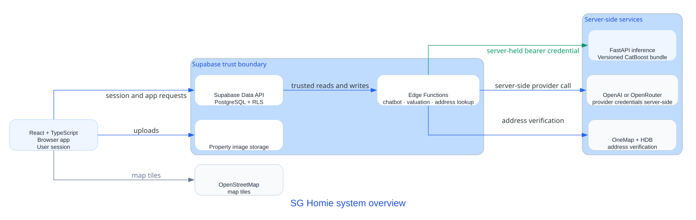

<div align="center">
  

  <h1>SG Homie</h1>
  <p><strong>The Housing Companion</strong><br />Singapore HDB housing decision support</p>

</div>

<table>
  <tr>
    <td align="center"><a href="#buyer-search"><strong>Search</strong><br />Browse approved HDB listings</a></td>
    <td align="center"><a href="#property-valuation"><strong>Valuation</strong><br />Explore a research/demo estimate</a></td>
    <td align="center"><a href="#conversational-assistant"><strong>Chatbot</strong><br />Ask about listings and seller drafts</a></td>
  </tr>
</table>

<p align="center">
  
  
  
  
</p>

SG Homie brings HDB listing discovery, seller workflows, property information, and conversational help into one web application. Valuation is a research/demo feature; estimates are not official valuations or financial advice.

## How it works



*The browser uses the signed-in user's Supabase session. Privileged provider and valuation credentials stay on the server.*

## What you can do

<a id="buyer-search"></a>
### Buyer search

Search approved HDB listings, open property details, and submit enquiries. The buyer chatbot can search and sort listings through a structured read-only application tool. It does not rank personalized recommendations.

<a id="property-valuation"></a>
### Property valuation

The authenticated valuation path accepts a property ID; the Supabase Edge Function reads data under the caller's access and builds model inputs server-side. A separate FastAPI service serves a versioned CatBoost research bundle. The output is an estimate, not an official valuation.

<a id="conversational-assistant"></a>
### Conversational assistant

The chatbot can explain trusted listing results and help sellers save listing drafts. Seller intake verifies the supplied HDB address; any suggested asking price is provisional AI guidance based on application asking listings, separate from the CatBoost valuation.

## What works today

| Label | Current state |
| --- | --- |
| **Implemented** | Buyer listing search, property details, enquiries, seller drafts, admin listing workflows, and structured buyer chatbot search are implemented in the repository. Hosted data and deployments are environment-specific. |
| **Research** | Buyer valuation uses a research/demo model and serving path. It is not approved for production use. |
| **Demo data** | Nearby amenity records are synthetic. Market analytics include generated or hardcoded values; they are not verified market evidence. |
| **Planned** | Explainable personalized ranking, real amenity ingestion, historical transaction analytics, and CatBoost-based seller pricing guidance are not implemented as those capabilities. |

## Technology and architecture

The frontend uses React, TypeScript, Vite, Tailwind CSS, React Router, and Leaflet. Supabase provides authentication, PostgreSQL with Row Level Security (RLS), Edge Functions, and property image storage. The valuation research service uses Python, FastAPI, and a persisted CatBoost bundle. OpenAI or OpenRouter may power chatbot flows through server-side configuration.

The architecture diagram describes repository boundaries; it does not verify a hosted deployment. See the [architecture guide](docs/architecture/README.md) for diagram sources and regeneration instructions.

## Quick start

Requirements: Node.js `^20.19.0` or `>=22.12.0` and npm.

```bash
cd SGHomie/FrontEnd
npm ci
cp .env.example .env
npm run dev
```

In PowerShell, copy the environment template with `Copy-Item .env.example .env`. Set `VITE_SUPABASE_URL` and `VITE_SUPABASE_ANON_KEY` in `.env`; `VITE_SUPABASE_FUNCTIONS_URL` is optional when using the configured project's functions. Keep service-role, OpenAI, OpenRouter, and OneMap credentials in server-side configuration. See the [Supabase setup guide](SGHomie/BackEnd/supabase/README.md) for backend setup and operations.

## Repository map

| Path | Contents |
| --- | --- |
| `SGHomie/FrontEnd/` | Active React, TypeScript, and Vite application |
| `SGHomie/BackEnd/supabase/` | Supabase configuration, migrations, seed data, and Edge Functions |
| `SGHomie/docs/` | Product workflow documentation |
| `MLPricePredictorV2/` | HDB valuation research, evaluation, bundle, and inference API |
| `MLPricePredictor/` | Legacy experiments containing target leakage; not trusted valuation evidence |
| `docs/architecture/` | Architecture diagram sources and regeneration guide |
| `archived_migrations/` | Historical migrations outside the active migration path |

## Documentation

- [Product direction and capability status](PRODUCT.md) · [Design system](DESIGN.md)
- [Supabase setup, migrations, and valuation serving](SGHomie/BackEnd/supabase/README.md)
- [Chatbot guide](SGHomie/docs/chatbot/README.md) · [Buyer flow](SGHomie/docs/buy-flow.md) · [Seller flow](SGHomie/docs/sell-flow.md)
- [V2 valuation research and inference](MLPricePredictorV2/README.md)
- [Archived migrations notice](archived_migrations/README.md)
- [Architecture diagrams and regeneration](docs/architecture/README.md)

## Contributors

<table>
  <tr>
    <td align="center"><a href="https://github.com/Nitecry7"><br /><sub><b>@Nitecry7</b></sub></a></td>
    <td align="center"><a href="https://github.com/Kappro"><br /><sub><b>@Kappro</b></sub></a></td>
    <td align="center"><a href="https://github.com/TyroneTiang"><br /><sub><b>@TyroneTiang</b></sub></a></td>
  </tr>
</table>
