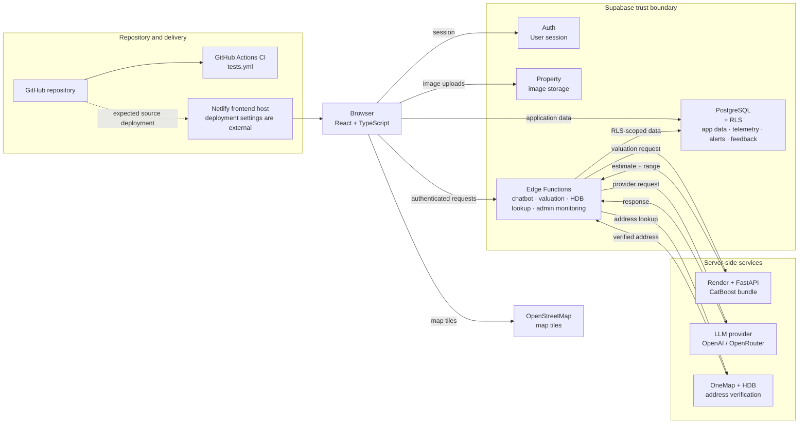
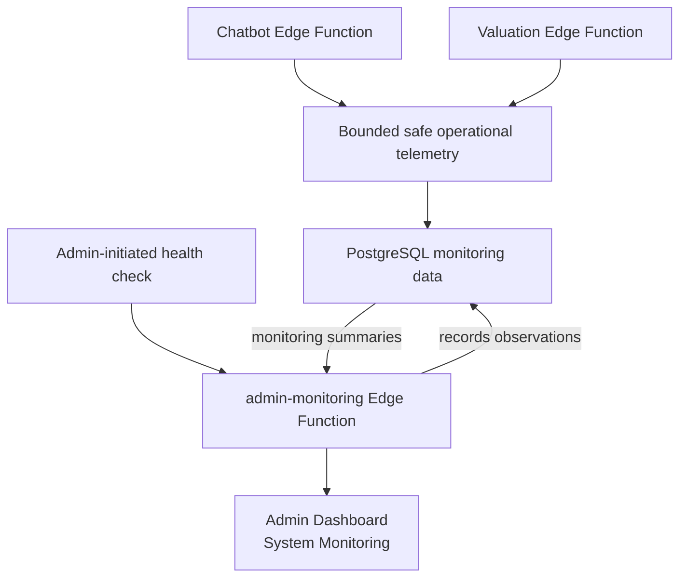
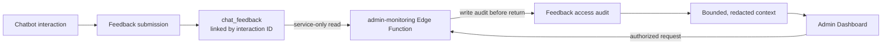

<div align="center">

  

  <h1>SG Homie 🫂</h1>

  <p>
    <strong>Welcome to SG Homie 🏠 Your Smart Housing Companion in Singapore 🌆</strong>
    <br />
    Let's help you find your dream home✨
  </p>

</div>

<table align="center">
  <tr>
    <td align="center" width="230">
      <a href="#buyer-search">
        <strong>🔎 Search</strong><br />
        Browse approved HDB listings
      </a>
    </td>
    <td align="center" width="230">
      <a href="#property-valuation">
        <strong>📊 Valuation</strong><br />
        Explore a research estimate
      </a>
    </td>
    <td align="center" width="230">
      <a href="#conversational-assistant">
        <strong>💬 Chatbot</strong><br />
        Ask about listings and seller drafts
      </a>
    </td>
  </tr>
</table>

<p align="center">
  <a href="https://github.com/Nitecry7/SC3040-Software-Engineering-Project/actions/workflows/tests.yml?query=branch%3Amain">
    
  </a>
  
  
  
  
  
  
  
</p>

<p align="center">
  <a href="https://sghomie.netlify.app/">Open the SG Homie live site</a>
  ·
  <a href="https://github.com/Nitecry7/SC3040-Software-Engineering-Project/actions/workflows/tests.yml">Repository CI workflow</a>
</p>

---

## ✨ About

SG Homie is a data-informed housing companion built to make Singapore HDB property decisions easier to explore and understand.

It brings together property discovery, seller listing workflows, structured conversational assistance, and a research-based resale valuation service in one web application.

The platform separates trusted application data, model-generated estimates, provisional AI guidance, and synthetic demo content so users can better understand what each feature represents.

> **Note:** The valuation feature is a research/demo capability. Its estimates are not official property valuations or financial advice.

---

## 🏗️ How it works



*GitHub Actions runs repository CI; Netlify hosts the frontend through separately configured deployment settings that are not present in this repository. A passing CI run does not verify the live site or its deployment. The browser uses the signed-in user's Supabase session. Render and LLM-provider credentials remain server-side. OneMap is used for HDB address verification, not nearby-amenity verification. This diagram describes repository architecture and does not by itself establish current hosted deployment state.*

### CI and deployment boundaries

GitHub Actions validates the repository on pull requests, pushes, and manual
dispatch. Netlify hosts the frontend; its production branch and deployment
settings are managed outside this repository. Supabase schema migrations and
Edge Functions require separate, deliberate deployment. The Render Blueprint
has automatic deployment turned off and pins a versioned valuation bundle.
Passing repository CI neither deploys these services nor verifies their hosted
configuration; use the [deployment runbook](SGHomie/docs/operations/deployment-runbook.md)
for controlled release checks.

---

## What you can do

<a id="buyer-search"></a>
### 🔎 Buyer search

Search approved HDB listings, open property details, and submit enquiries. The buyer chatbot can search and sort listings through a structured, read-only application tool. This is not personalized recommendation ranking.

<a id="property-valuation"></a>
### 📊 Property valuation

The authenticated valuation path accepts a property ID; the Supabase Edge Function reads data under the caller's access and builds model inputs server-side. A separate FastAPI service serves a versioned CatBoost research bundle. The result is an estimate, not an official property valuation. Current asking listing prices and completed HDB resale transactions are different data.

<a id="conversational-assistant"></a>
### 💬 Conversational assistant

The chatbot can explain trusted listing results and help sellers save listing drafts through structured application tools; it does not have arbitrary database access. Seller intake verifies the supplied HDB address. A seller's provisional AI asking-price suggestion is based on application asking listings and is separate from the CatBoost buyer valuation.

Full AI chat requires login. Anonymous Buy/Sell provide deterministic onboarding
without invoking an AI provider; other anonymous messages receive sign-up/login
guidance. Explore remains login-protected. **New chat** clears temporary messages
and buyer/seller context while preserving login, saved preferences and drafts.

## What works today

| Status | Capability in this repository |
| --- | --- |
| ✅ **Implemented** | Buyer listing search, property details, enquiries, seller drafts, admin listing workflows, structured buyer chatbot search, and the repository synthetic-check framework with bounded feedback inspection. Hosted Chatbot synthetic-check authentication remains deferred; no continuous availability monitoring is implemented. This describes repository code, not hosted deployment. |
| 🧪 **Research/demo** | Buyer valuation uses a research model and serving path. Its estimate and conformal target coverage do not provide an official valuation or a property-specific probability guarantee. |
| 🏷️ **Demo data** | Nearby amenity records are synthetic demo data, not verified facilities. Market analytics include generated or hardcoded values; they are not verified market evidence. HDB address verification does not prove that every listing fact is genuine. |
| 🛠️ **Planned** | Explainable personalized ranking, real amenity ingestion, historical transaction analytics, and CatBoost-based seller pricing guidance are not implemented. Search and sorting are not personalized recommendation ranking. |

The hosted chatbot synthetic-canary authentication issue remains deferred. No successful hosted chatbot authentication or production availability check is claimed; repository checks and the internal fixed-marker probe do not exercise the authenticated user journey.


---

## 🛠️ Technology & Architecture

<p align="center">
  
  
  
  
  
  
  
  
  
  
</p>

### 🖥️ Frontend Development

- ⚛️ **React**: Component-based user interface and application views
- 🔷 **TypeScript**: Typed frontend development
- 🎨 **Tailwind CSS**: Responsive styling and reusable visual patterns
- 🛣️ **React Router**: Client-side application routing
- ⚡ **Vite**: Development server and frontend build tooling
- 🗺️ **Leaflet / React Leaflet**: Interactive property maps

### 🔥 Backend & Data

- 🔥 **Supabase**: Authentication, PostgreSQL access, Edge Functions, and property image storage
- 🐘 **PostgreSQL**: Application data for users, listings, enquiries, seller drafts, and related records
- 🛡️ **Row Level Security (RLS)**: Session-scoped access control for application data
- ⚡ **Supabase Edge Functions**: Trusted server-side workflows for chatbot, valuation, and HDB address lookup
- 🖼️ **Supabase Storage**: Property image storage and policy-controlled uploads

### 🤖 Machine Learning & Inference

- 🐍 **Python**: Data preparation, model research, evaluation, and inference tooling
- 📊 **CatBoost**: Selected HDB resale-price point estimator
- 📐 **Conformal Calibration**: Produces the model's calibrated likely market range
- ⚡ **FastAPI**: HTTP inference API around the versioned valuation bundle
- ☁️ **Render**: Hosts the FastAPI valuation service and loads the released model artifact

### 🌐 External Services

- 🤖 **OpenAI / OpenRouter**: Server-configured LLM providers for conversational workflows
- 📍 **OneMap**: Postal-code geocoding used during HDB address verification
- 🏢 **Official HDB Property Information**: Used to validate residential HDB addresses
- 🗺️ **OpenStreetMap**: Map tiles used by the property-map interface
- 📂 **data.gov.sg / HDB Resale Data**: Historical completed resale transactions used for valuation research

### 🔐 Architecture & Trust Boundaries

- 👤 **Authenticated browser access**: The frontend operates using the signed-in user's Supabase session.
- 🛡️ **RLS-protected data access**: Supabase applies authentication and Row Level Security before application data is accessed.
- ⚙️ **Trusted Edge Functions**: Sensitive application workflows such as chatbot orchestration, HDB lookup, and valuation requests run server-side.
- 🔑 **Server-held credentials**: Render, OpenAI, OpenRouter, and OneMap credentials are never sent to the browser.
- 🤖 **Controlled AI access**: LLM providers assist with conversation and structured extraction, while application code remains responsible for validation, database access, and persistence.

#### 📊 Valuation Flow

**Browser → Supabase Edge Function → Render FastAPI → CatBoost**

The browser sends the property ID together with authenticated session context.

The Edge Function:

- Authenticates the caller
- Reads trusted property data under RLS
- Constructs model features server-side
- Sends the trusted feature request to Render using a separate server-held credential

Render's FastAPI service loads the versioned CatBoost bundle and returns the estimate and calibrated range.

#### 💬 Chatbot Flow

**Browser → Supabase chatbot Edge Function → validated application tools / configured LLM provider**

The chatbot Edge Function controls:

- Tool validation
- Listing searches
- Seller draft persistence
- HDB address verification
- Provider requests

The LLM does not have arbitrary SQL access and does not directly control database reads or writes.

### 📈 Monitoring and Feedback Architecture

Monitoring is application-level operational observability, not a continuous outside-in uptime platform. Chatbot and valuation operations persist bounded operational signals for the Admin Dashboard. Admin-initiated health checks run through `admin-monitoring` and record observations in PostgreSQL. Feedback is linked to chatbot interactions where supported; not every interaction has feedback. Authorized inspection happens server side, is audited before content is returned, and provides bounded conversation context. Stored text is subject to the implemented redaction and expiry controls; this does not make arbitrary chatbot conversations publicly accessible.





The hosted Chatbot synthetic check remains deferred because service-to-service authentication integration was not completed for the final release. One hosted Valuation synthetic check was previously observed succeeding as a point-in-time check; neither that observation nor repository telemetry establishes continuous availability monitoring. See the [monitoring test plan](SGHomie/docs/operations/monitoring-test-plan.md) and [chatbot guide](SGHomie/docs/chatbot/README.md) for implementation details and verification limits.

---

## 🚀 Quick Start

### 📋 Prerequisites

- 📦 **Node.js**: `^20.19.0` or `>=22.12.0`
- 🔴 **npm**
- 🔥 **Supabase**: A compatible hosted or local project configuration

### 1️⃣ Clone & Navigate

```bash
git clone https://github.com/Nitecry7/SC3040-Software-Engineering-Project.git
cd SC3040-Software-Engineering-Project/SGHomie/FrontEnd
```

### 2️⃣ Install Dependencies

The frontend includes a `package-lock.json`, so use the reproducible install:

```bash
npm ci
```

### 3️⃣ Configure Environment

Copy `.env.example` to `.env`.

#### macOS / Linux

```bash
cp .env.example .env
```

#### Windows PowerShell

```powershell
Copy-Item .env.example .env
```

Set these browser-safe values inside `.env`:

```env
VITE_SUPABASE_URL=
VITE_SUPABASE_ANON_KEY=
```

`VITE_SUPABASE_FUNCTIONS_URL` is optional when using the Edge Functions associated with `VITE_SUPABASE_URL`.

> 🔐 **Security:** Do not place service-role keys, OpenAI keys, OpenRouter keys, OneMap credentials, Render service tokens, or other privileged secrets in the frontend environment file. Vite environment variables are exposed to browser code.

### 4️⃣ Launch Development Server

```bash
npm run dev
```

🚀 Open the local URL printed by Vite in your terminal.

For Supabase backend setup, migrations, local Edge Functions, and server-side secrets, see the [Supabase README](SGHomie/BackEnd/supabase/README.md).

---
## 🏗️ Project Structure

```text
SC3040-Software-Engineering-Project/
├── SGHomie/                              # 🏠 Main application
│   ├── FrontEnd/                         # 🖥️ React + TypeScript frontend
│   │   ├── src/                          # ℹ️ Application source
│   │   ├── package.json                 # 📜 Frontend dependencies and scripts
│   │   ├── package-lock.json            # 🔐 Reproducible dependency lockfile
│   │   └── vite.config.ts               # ⚡Vite configuration
│   ├── BackEnd/
│   │   └── supabase/                    # 🔥 Supabase backend
│   │       ├── functions/               # </> Edge Functions
│   │       ├── migrations/              # ⛃ Database migrations
│   │       ├── seed.sql                 # 🌱 Local demo seed
│   │       └── README.md                # 📝 Backend setup and serving notes
│   └── docs/                            # 📖 Product workflow documentation
│       ├── chatbot/README.md            # 🤖 Chatbot architecture
│       ├── buy-flow.md                  # 🛒 Buyer chatbot flow
│       └── sell-flow.md                 # 👨‍💼 Seller chatbot flow
├── MLPricePredictorV2/                  # 🔬 Current leakage-safe research and inference path
├── MLPricePredictor/                    # ⚠️ Legacy experiments with target leakage; not trusted valuation evidence
├── archived_migrations/                 # 🏛️ Historical migrations outside the active path
├── PRODUCT.md                           # 🎯 Product direction and status
├── DESIGN.md                            # 🎨 Design system
├── render.yaml                          # ☁️ Render inference configuration
└── README.md                            # 📌 Project overview
```

Within `SGHomie/FrontEnd/src/`, `App.tsx` defines the routes and application shell.
`pages/` contains route pages, `components/` contains reusable UI, `contexts/`
holds shared React context, and `lib/` contains application helpers and service
integration logic. `hooks/` and `types/` contain shared hooks and TypeScript types.

## 📚 Documentation

| Guide | What it covers |
| --- | --- |
| 🤝 [Contributing](CONTRIBUTING.md) | Local development, verification, and contribution guidance |
| 🎯 [Product direction](PRODUCT.md) | Intended capabilities and current status |
| 🎨 [Design system](DESIGN.md) | Existing product visual language |
| 🔥 [Supabase backend and valuation serving](SGHomie/BackEnd/supabase/README.md) | Backend setup, migrations, RLS, and serving path |
| 💬 [Chatbot architecture](SGHomie/docs/chatbot/README.md) | Structured buyer and seller flows |
| 🧪 [Chatbot behavioral evaluations](SGHomie/evals/chatbot/README.md) | Deterministic regression suite and opt-in live checks |
| 🔍 [Buyer chatbot flow](SGHomie/docs/buy-flow.md) | Buyer search tool and response behavior |
| 🏠 [Seller chatbot flow](SGHomie/docs/sell-flow.md) | Seller address verification and draft workflow |
| ⚙️ [Deployment runbook](SGHomie/docs/operations/deployment-runbook.md) | Service ownership, release boundaries, and safe deployment checks |
| 📈 [Monitoring and test plan](SGHomie/docs/operations/monitoring-test-plan.md) | Current signals, production checks, and phased roadmap |
| 🤖 [Valuation research and inference](MLPricePredictorV2/README.md) | Leakage-safe research, evaluation, bundle, and API |
| 🧪 [Historical testing report](SGHomie/docs/testing/test-report.md) | Original pre-merge results and preserved evidence |
| 🔄 [Historical main merge verification](SGHomie/docs/testing/merge-verification.md) | 28 October 2026 `main` snapshot, retained as historical evidence |
| ▶️ [Running the tests](SGHomie/tests/README.md) | Final `main` release verification, application, ML, local database, evidence capture, and CI commands |
| ⚠️ [Archived migrations](archived_migrations/README.md) | Historical migration notice |

## 👥 Contributors

<table>
  <tr>
    <td align="center"><a href="https://github.com/Nitecry7"><br /><sub><b>@Nitecry7</b></sub></a></td>
    <td align="center"><a href="https://github.com/Kappro"><br /><sub><b>@Kappro</b></sub></a></td>
    <td align="center"><a href="https://github.com/TyroneTiang"><br /><sub><b>@TyroneTiang</b></sub></a></td>
  </tr>
</table>

<div align="center">

Made with ❤️ by the SG Homie Team
</div>
