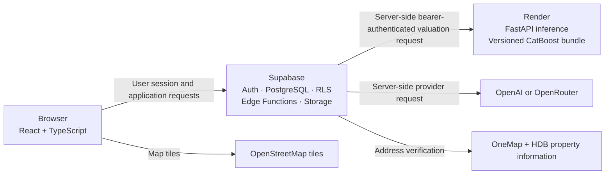

<div align="center">
  

  <h1>SG Homie</h1>
  <p>A data-informed companion for Singapore HDB housing decisions.</p>
</div>

SG Homie brings HDB listing discovery, seller workflows, property information, and conversational help into one web application. Its current tools combine application listing data with a research/demo valuation service. Estimates are not official valuations or financial advice.

## What the platform does

| For | Current workflows |
| --- | --- |
| Buyers | Search approved HDB listings, inspect property details, submit enquiries, and ask the chatbot to search listings using structured filters. |
| Sellers | Verify an HDB address, create and manage listing drafts, and submit listings for review. Chat intake can save a draft for later completion in the Seller Dashboard. |
| Administrators | Review listings and use the available administrative workflows. |

The chatbot can suggest a provisional asking price during seller intake from application asking listings. This is AI guidance, not the CatBoost valuation or completed-transaction evidence.

## Technology

<p>
  
  
  
  
  
  
</p>

The frontend also uses Tailwind CSS, React Router, and Leaflet. Supabase provides authentication, PostgreSQL with Row Level Security (RLS), Edge Functions, and property image storage. Python/FastAPI serves the persisted CatBoost research bundle. OpenAI or OpenRouter can power chatbot flows through server-side configuration. OneMap and HDB property information support seller address verification; OpenStreetMap tiles provide map backgrounds.

## Architecture at a glance

The browser talks to Supabase using the user's session and the browser-safe Supabase key. Supabase applies authentication and RLS, and its Edge Functions coordinate trusted operations. Only the valuation Edge Function calls the Render inference service with a server-held credential. Chat provider credentials also remain server-side.



This diagram describes repository architecture and the reported valuation serving path; it does not establish current hosted configuration. Detailed generator source for four architecture diagrams is in [`docs/architecture`](docs/architecture/README.md). SVG rendering requires Python and Graphviz; those prerequisites were unavailable in the environment used for this change, so no rendered diagrams are included yet.

## Property valuation

The buyer-facing valuation flow is **Property Details → Supabase valuation Edge Function → Render FastAPI → Property Details**. The browser sends only a `property_id` with the authenticated Supabase session. The Edge Function checks the caller and reads the property under that caller's RLS access, constructs model features on the server, and sends the prediction request to Render with a separate server-held credential. The browser never receives the Render credential or supplies raw model features.

FastAPI loads a versioned CatBoost bundle and returns a point estimate with a conformal range. The asking price, when available, is used to classify its position relative to the range. A request ID correlates logs; it is not an authentication token. The bundle is research/demo quality, not an approved production valuation. One authenticated hosted request was user-reported as successful on 2026-10-18; this is not a benchmark or service guarantee. See the [valuation serving notes](SGHomie/BackEnd/supabase/README.md#valuation-integration-and-demo-provenance) for the dated observation.

### Training and inference are separate

Training and evaluation happen offline in `MLPricePredictorV2/`: HDB resale data is prepared, leakage-safe features and chronological splits are used, candidate models and uncertainty ranges are evaluated, and a versioned bundle is built. Render fetches and loads a released bundle to serve requests; it does not train a model during inference. The legacy `MLPricePredictor/` directory contains target leakage and is not trusted valuation evidence.

See [V2 research methods and results](MLPricePredictorV2/README.md) for the evaluation, data provenance, bundle format, and inference API.

## Conversational assistant

The React chat UI calls the Supabase `chatbot` Edge Function. A server-configured provider (OpenAI or OpenRouter) supports conversation, while application tools perform bounded work:

- **Buyer search:** the structured, read-only `search_listings` tool queries approved HDB listings. The LLM may explain returned records; it is not a recommendation-ranking engine and must not invent listing facts.
- **Seller intake:** the provider extracts supplied details into a validated structure. The function verifies the HDB address through the location lookup and saves an owner-bound draft. The seller reviews and completes it in the dashboard before submitting.

The chatbot does not have arbitrary SQL access. Seller price suggestions are provisional AI guidance and are separate from the CatBoost buyer valuation. Read the [buyer flow](SGHomie/docs/buy-flow.md) and [seller flow](SGHomie/docs/sell-flow.md) for details.

## Capability status

| Area | Status |
| --- | --- |
| HDB listing search, property details, enquiries, seller drafts, and admin listing workflows | Implemented in the repository; hosted data and deployments are environment-specific. |
| Buyer chatbot structured listing search | Implemented in the repository; current hosted provider/configuration is not verified here. |
| Seller chatbot intake and HDB address verification | Implemented in the repository; OneMap/provider secrets and hosted function state are not verified here. |
| Buyer property valuation through Supabase and Render | Research/demo path; one user-reported hosted request succeeded on 2026-10-18. Not production-approved. |
| Nearby amenity records and market analytics | Demo content. Amenity rows are synthetic; analytics contain generated or hardcoded values. |
| Seller CatBoost pricing guidance, explainable recommendation ranking, real amenity ingestion, and historical transaction analytics | Planned; not implemented as those capabilities. |

## Run the frontend locally

The current Vite toolchain requires Node.js `^20.19.0` or `>=22.12.0` and npm.

```bash
cd SGHomie/FrontEnd
npm ci
cp .env.example .env
npm run dev
```

In PowerShell, use `Copy-Item .env.example .env` for the copy step. Set `VITE_SUPABASE_URL` and `VITE_SUPABASE_ANON_KEY` in `.env`; `VITE_SUPABASE_FUNCTIONS_URL` is optional when using the configured project's functions. Only browser-safe Supabase values belong in this file. Keep service-role, OpenAI, OpenRouter, and OneMap credentials in server-side configuration.

See the [Supabase guide](SGHomie/BackEnd/supabase/README.md) for backend setup, local functions, migrations, and deployment procedures.

## Repository layout

```text
AGENTS.md                         Repository instructions
PRODUCT.md                        Product direction and capability boundaries
DESIGN.md                         Frontend design system snapshot
SGHomie/FrontEnd/                 Active React, TypeScript, and Vite app
SGHomie/BackEnd/supabase/         Supabase config, migrations, and Edge Functions
SGHomie/docs/                     Buyer and seller chatbot flow guides
docs/architecture/                Diagram source and regeneration instructions
MLPricePredictorV2/               Leakage-safe valuation research and serving
MLPricePredictor/                 Legacy experiments with target leakage
render.yaml                       Render service blueprint for valuation inference
archived_migrations/              Historical migrations
```

## Documentation

- [Product direction and status](PRODUCT.md)
- [Design system](DESIGN.md)
- [Supabase setup and valuation serving](SGHomie/BackEnd/supabase/README.md)
- [Chatbot buyer flow](SGHomie/docs/buy-flow.md) · [seller flow](SGHomie/docs/sell-flow.md)
- [V2 valuation research and inference](MLPricePredictorV2/README.md)
- [Architecture diagram source and regeneration](docs/architecture/README.md)

## Contributors

<table>
  <tr>
    <td align="center"><a href="https://github.com/Nitecry7"><br /><sub><b>@Nitecry7</b></sub></a></td>
    <td align="center"><a href="https://github.com/Kappro"><br /><sub><b>@Kappro</b></sub></a></td>
    <td align="center"><a href="https://github.com/TyroneTiang"><br /><sub><b>@TyroneTiang</b></sub></a></td>
  </tr>
</table>
