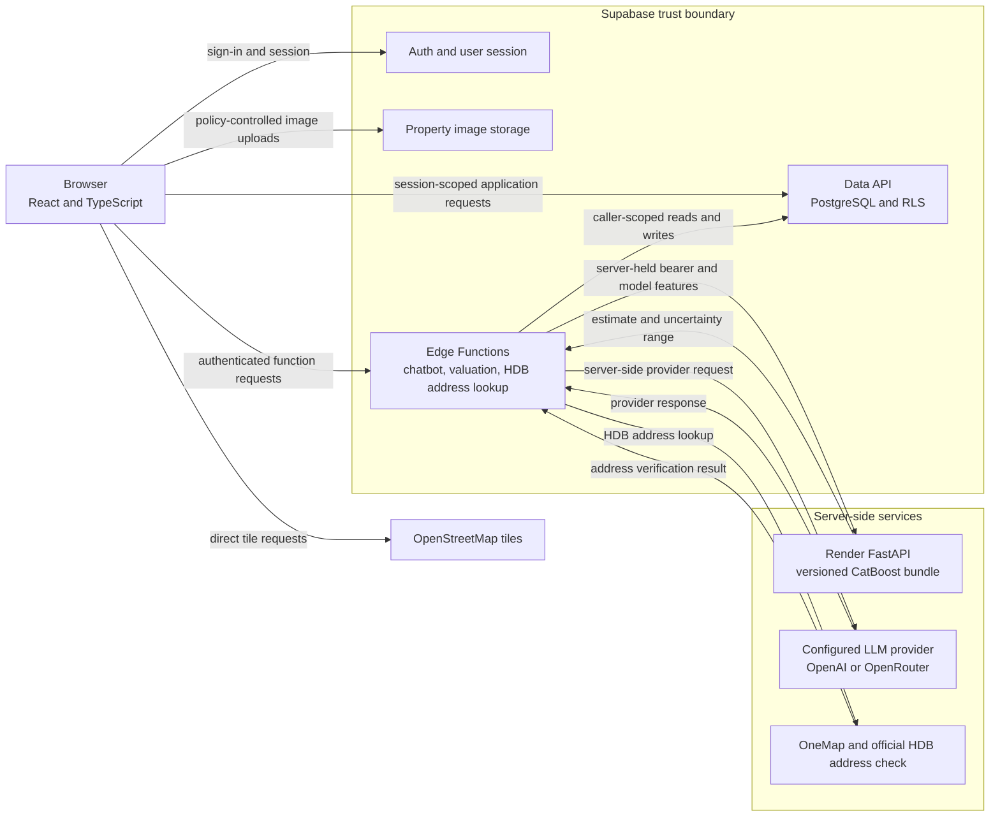

<div align="center">
  

  <h1>SG Homie</h1>
  <p><strong>Welcome to SG Homie 🏠 Your Smart Housing Companion in Singapore 🌆</strong><br />Helping you find your dream home✨</p>
</div>

<table>
  <tr>
    <td align="center"><a href="#buyer-search"><strong>🔎 Search</strong><br />Browse approved HDB listings</a></td>
    <td align="center"><a href="#property-valuation"><strong>📊 Valuation</strong><br />Explore a research estimate</a></td>
    <td align="center"><a href="#conversational-assistant"><strong>💬 Chatbot</strong><br />Ask about listings and seller drafts</a></td>
  </tr>
</table>

<p align="center">
  
  
  
  
  
  
</p>

SG Homie brings HDB listing discovery, seller workflows, property information, and conversational help into one web application. Valuation is a research/demo feature; estimates are not official valuations or financial advice.

## How it works



*The browser uses the signed-in user's Supabase session. The Render service credential and provider credentials stay server-side. OneMap is used for HDB address verification, not nearby-amenity verification. This diagram describes repository architecture, not current hosted deployment.*

## What you can do

<a id="buyer-search"></a>
### 🔎 Buyer search

Search approved HDB listings, open property details, and submit enquiries. The buyer chatbot can search and sort listings through a structured, read-only application tool. This is not personalized recommendation ranking.

<a id="property-valuation"></a>
### 📊 Property valuation

The authenticated valuation path accepts a property ID; the Supabase Edge Function reads data under the caller's access and builds model inputs server-side. A separate FastAPI service serves a versioned CatBoost research bundle. The result is an estimate, not an official property valuation. Current asking listing prices and completed HDB resale transactions are different data.

<a id="conversational-assistant"></a>
### 💬 Conversational assistant

The chatbot can explain trusted listing results and help sellers save listing drafts through structured application tools; it does not have arbitrary database access. Seller intake verifies the supplied HDB address. A seller's provisional AI asking-price suggestion is based on application asking listings and is separate from the CatBoost buyer valuation.

## What works today

| Status | Capability in this repository |
| --- | --- |
| ✅ **Implemented** | Buyer listing search, property details, enquiries, seller drafts, admin listing workflows, and structured buyer chatbot search. This describes repository code, not current hosted deployment. |
| 🧪 **Research/demo** | Buyer valuation uses a research model and serving path. Its estimate and conformal target coverage do not provide an official valuation or a property-specific probability guarantee. |
| 🏷️ **Demo data** | Nearby amenity records are synthetic demo data, not verified facilities. Market analytics include generated or hardcoded values; they are not verified market evidence. HDB address verification does not prove that every listing fact is genuine. |
| 🛠️ **Planned** | Explainable personalized ranking, real amenity ingestion, historical transaction analytics, and CatBoost-based seller pricing guidance are not implemented. Search and sorting are not personalized recommendation ranking. |

One authenticated hosted valuation request was user-reported successful on 2026-10-18. That dated observation is not independent verification of current deployment, a benchmark, or a service guarantee; see the [Supabase serving notes](SGHomie/BackEnd/supabase/README.md#hosted-serving-observation-and-log-correlation).

## Technology and architecture

<p align="center">
  
  
  
  
</p>

The frontend uses React, TypeScript, Vite, Tailwind CSS, React Router, and Leaflet. Supabase provides authentication, PostgreSQL with Row Level Security (RLS), Edge Functions, and property image storage. The valuation research service uses Python, FastAPI, and a persisted CatBoost bundle. OpenAI or OpenRouter may power chatbot flows through server-side configuration.

The browser uses the user's Supabase session for application access. The Edge Function applies the caller's access policies; privileged service credentials and model/provider secrets stay on the server. The architecture diagram describes repository boundaries and does not verify a hosted deployment.

## Quick Start

Requirements: Node.js `^20.19.0` or `>=22.12.0` and npm.

### 1️⃣ Get the code

From the repository root:

```bash
cd SGHomie/FrontEnd
```

### 2️⃣ Install dependencies

The frontend has a `package-lock.json`, so use the reproducible install:

```bash
npm ci
```

### 3️⃣ Configure environment

Copy `.env.example` to `.env`:

```bash
cp .env.example .env
```

In PowerShell:

```powershell
Copy-Item .env.example .env
```

Set these browser-safe values in `.env`:

- `VITE_SUPABASE_URL`
- `VITE_SUPABASE_ANON_KEY`

`VITE_SUPABASE_FUNCTIONS_URL` is optional; leave it blank to use the Edge Functions configured with `VITE_SUPABASE_URL`.

Do not place service-role, OpenAI, OpenRouter, OneMap, or other privileged secrets in the frontend environment file. Vite variables are exposed to browser code.

### 4️⃣ Launch local development server

```bash
npm run dev
```

🚀 Open the local URL printed by Vite in your terminal. For Supabase backend, local functions, migrations, and secrets setup, see the [Supabase README](SGHomie/BackEnd/supabase/README.md).

## 🏗️ Project Structure

```text
SC3040-Software-Engineering-Project/
├── SGHomie/                              # 🏠 Main application
│   ├── FrontEnd/                         # 🖥️ React + TypeScript frontend
│   │   ├── src/                          # ℹ️ Application source
│   │   ├── package.json                 # 📜 Frontend dependencies and scripts
│   │   ├── package-lock.json            # 🔐 Reproducible dependency lockfile
│   │   └── vite.config.ts               # ⚡Vite configuration
│   ├── BackEnd/
│   │   └── supabase/                    # 🔥 Supabase backend
│   │       ├── functions/               # </> Edge Functions
│   │       ├── migrations/              # ⛃ Database migrations
│   │       ├── seed.sql                 # 🌱 Local demo seed
│   │       └── README.md                # 📝 Backend setup and serving notes
│   └── docs/                            # 📖 Product workflow documentation
│       ├── chatbot/README.md            # 🤖 Chatbot architecture
│       ├── buy-flow.md                  # 🛒 Buyer chatbot flow
│       └── sell-flow.md                 # 👨‍💼 Seller chatbot flow
├── MLPricePredictorV2/                  # 🔬 Current leakage-safe research and inference path
├── MLPricePredictor/                    # ⚠️ Legacy experiments with target leakage; not trusted valuation evidence
├── archived_migrations/                 # 🏛️ Historical migrations outside the active path
├── PRODUCT.md                           # 🎯 Product direction and status
├── DESIGN.md                            # 🎨 Design system
├── render.yaml                          # ☁️ Render inference configuration
└── README.md                            # 📌 Project overview
```

## 📚 Documentation

| Guide | What it covers |
| --- | --- |
| 🎯 [Product direction](PRODUCT.md) | Intended capabilities and current status |
| 🎨 [Design system](DESIGN.md) | Existing product visual language |
| 🔥 [Supabase backend and valuation serving](SGHomie/BackEnd/supabase/README.md) | Backend setup, migrations, RLS, and serving path |
| 💬 [Chatbot architecture](SGHomie/docs/chatbot/README.md) | Structured buyer and seller flows |
| 🔍 [Buyer chatbot flow](SGHomie/docs/buy-flow.md) | Buyer search tool and response behavior |
| 🏠 [Seller chatbot flow](SGHomie/docs/sell-flow.md) | Seller address verification and draft workflow |
| 🤖 [Valuation research and inference](MLPricePredictorV2/README.md) | Leakage-safe research, evaluation, bundle, and API |
| ⚠️ [Archived migrations](archived_migrations/README.md) | Historical migration notice |

## 👥 Contributors

<table>
  <tr>
    <td align="center"><a href="https://github.com/Nitecry7"><br /><sub><b>@Nitecry7</b></sub></a></td>
    <td align="center"><a href="https://github.com/Kappro"><br /><sub><b>@Kappro</b></sub></a></td>
    <td align="center"><a href="https://github.com/TyroneTiang"><br /><sub><b>@TyroneTiang</b></sub></a></td>
  </tr>
</table>

<div align="center">

Made with ❤️ by the SG Homie Team
</div>
