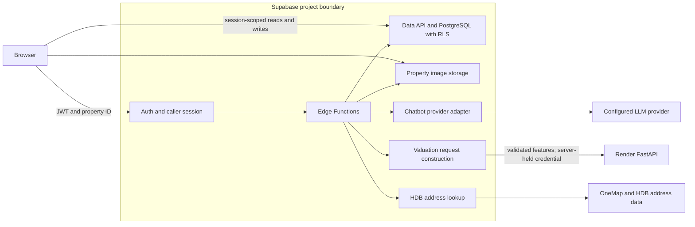
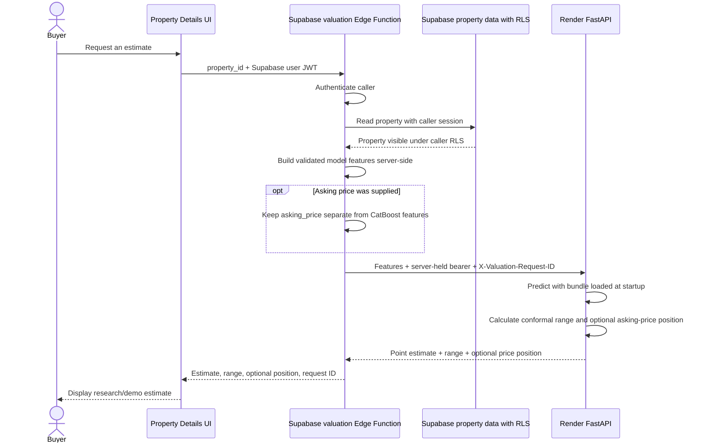

# Supabase setup

This guide covers the active Supabase schema, server-side functions, valuation path, provider configuration, and property image storage. Repository files describe intended setup; confirm the target project's migration history, secrets, and deployments in Supabase before relying on hosted state.



*This is the backend source architecture. Repository configuration does not establish current hosted deployment or provider state.*

| Need | Section |
| --- | --- |
| Understand the authenticated valuation request | [Valuation request flow](#valuation-request-flow) |
| Review demo amenity and valuation provenance | [Demo data and provenance](#deterministic-demo-amenities) · [Valuation integration](#valuation-integration-and-demo-provenance) |
| Preview migrations and apply schema changes | [Reset and push the schema](#reset-and-push-the-schema) |
| Configure address lookup or chatbot provider | [HDB postal-code lookup](#hdb-postal-code-lookup) · [Chatbot provider selection](#chatbot-provider-selection) |
| Configure property image cleanup | [Property image storage and cleanup](#property-image-storage-and-cleanup) |

The chatbot Buy flow, listing-search tool contract, verification and deployment
steps are documented in [Chatbot buy flow](../../docs/buy-flow.md).
The seller intake, provisional pricing, partial drafts and saved-draft card are
documented in [Chatbot sell flow](../../docs/sell-flow.md).

For visual overviews of both structured chatbot paths, see the [chatbot guide](../../docs/chatbot/README.md).

The active migration path contains **24 SQL migrations**: one complete initial
schema followed by timestamp-ordered incremental changes.

1. `20250328092626_sghomie_initial.sql` — initial application schema and policies.
2. `20260916120000_hdb_postal_lookup.sql` — HDB postal-code lookup support.
3. `20260916133000_property_image_storage.sql` — property image storage policies.
4. `20260916140000_remove_vault_image_cleanup.sql` — removes Vault-based image cleanup.
5. `20260917090000_chatbot_sell_drafts.sql` — seller chatbot draft support.
6. `20260917100000_admin_role_exclusivity.sql` — admin-role constraints.
7. `20260917110000_chatbot_rate_limits.sql` — initial chatbot rate limits.
8. `20260917120000_hdb_verification_tokens.sql` — server-enforced HDB write verification.
9. `20260917130000_remove_chatbot_rate_limits.sql` — removes the chatbot counter.
10. `20261008120000_deterministic_demo_property_amenities.sql` — amenity provenance and deterministic demo records.
11. `20261012120000_property_valuation_inputs.sql` — nullable, provenance-labelled valuation inputs.
12. `20261013120000_property_storey_range.sql` — property storey-range support.
13. `20261013130000_preserve_explicit_property_coordinates.sql` — preserves explicitly supplied coordinates.
14. `20261013140000_property_demo_batch_provenance.sql` — canonical demo-batch provenance and eligibility invariants.
15. `20261013150000_require_approved_demo_valuations.sql` — requires approved listings for demo valuations.
16. `20261026120000_authenticated_enquiry_insert.sql` — binds enquiry inserts to the authenticated caller.
17. `20261026130000_chatbot_quotas_and_capacity.sql` — user quotas, provider capacity, and bounded cooldown state.
18. `20261026140000_chat_telemetry_privacy_feedback.sql` — private interaction metadata, caller-owned feedback, and service-only cleanup.
19. `20261026150000_redact_singapore_phone_feedback.sql` — best-effort Singapore phone redaction in feedback comments.
20. `20261031120000_phase7_monitoring_data_api.sql` — restricted monitoring data access.
21. `20261031130000_phase7_monitoring_recent_feedback.sql` — recent feedback summaries for monitoring.
22. `20261031140000_phase7_feedback_inspection.sql` — bounded admin feedback inspection.
23. `20261031141000_phase7_feedback_access_audit.sql` — audit records for feedback inspection.
24. `20261031150000_phase7_synthetic_canary_runs.sql` — privacy-safe persisted synthetic-check results.

The initial migration creates the full application schema, policies, views, and
triggers for a fresh Supabase project. Later migrations must be applied in
timestamp order with the initial schema.

### Chatbot quotas and provider capacity

The chatbot quota migration defines configurable `standard`, `tester` and
`privileged` policy rows, protected tier assignments, bounded per-user state and
a singleton project provider-capacity state. Initial application defaults are
2/5 interactions per minute/day for standard, 10/25 for tester, and 20/minute
with no per-user daily cap for privileged. A repeated burst-denial policy starts
a 15-minute chatbot cooldown after five denials within ten minutes. The initial
project reserve is 18 provider calls per minute and 45 per Singapore calendar
day. These values are application settings, not guarantees about upstream
provider capacity. PostgreSQL calculates the next Singapore calendar-day reset
and returns its timestamp in quota snapshots; the frontend displays that
server-provided weekday, date and time instead of estimating when access will
return.

The authenticated `reserve_chat_user_interaction()` RPC derives the user from
`auth.uid()`. The `service_role`-only `reserve_chat_provider_call()` RPC protects
the global reserve and cannot be called by ordinary authenticated users. Both
functions serialize updates with row locks. Tier assignments and settings are
trusted database operations; users cannot read or write those tables through
the Data API. Admin or seller status does not grant a quota tier. To assign an
authorized test account, confirm the target Supabase project, copy the account's
Auth UUID from the Dashboard, then run this in the trusted SQL Editor:

```sql
INSERT INTO public.chat_quota_assignments (user_id, tier)
VALUES ('<auth-user-uuid>'::uuid, 'privileged')
ON CONFLICT (user_id) DO UPDATE SET tier = EXCLUDED.tier, updated_at = now();
```

Verify the account's next authenticated quota response reports `tier: privileged`,
`minute_limit: 20`, `daily_limit: null` and `daily_remaining: null`. Privileged
accounts still share the project-wide 18 provider calls/minute and 45/day caps,
and remain subject to burst-abuse cooldowns. To assign `tester`, replace
`'privileged'` above with `'tester'` and verify the returned tier and limits.

Delete the assignment to restore the default `standard` tier:

```sql
DELETE FROM public.chat_quota_assignments WHERE user_id = '<auth-user-uuid>'::uuid;
```

Only a trusted database operator should run these statements or update the
configuration tables. Do not grant table access or expose a tier-assignment RPC
to authenticated users. After
applying the migration, deploy the `chatbot` Edge Function and verify both the
migration and function version in the target Supabase project. The function
requires the platform-provided `SUPABASE_SERVICE_ROLE_KEY` only in its server
environment; do not copy it to frontend configuration. No migration or
function deployment is performed by this guide.

### Chatbot telemetry, feedback and retention

The Phase 4 migration stores one row for each authenticated AI interaction and
one child row per outbound provider attempt. Anonymous onboarding and
deterministic seller steps are excluded. User/assistant text is best-effort
redacted before insert; seller workflow text is omitted. Redaction is not
guaranteed to find every sensitive value. Normal Data API roles have no direct
access to telemetry tables. `submit_chat_feedback()` derives ownership from
`auth.uid()`, accepts only completed successful interactions, validates
structured reasons and upserts one rating per interaction. Written feedback is
redacted in the function before storage.

`cleanup_chat_content()` clears redacted conversation text and written feedback
after 30 days, closes stale `started` records after one hour, and drops
user/conversation linkage when content expires while retaining metadata and
structured reasons. Account deletion cascades while the user linkage remains.
The cleanup function is granted only to `service_role`. To enable recurring
cleanup, configure a daily Supabase Dashboard Cron job to run:

```sql
SELECT public.cleanup_chat_content();
```

Dashboard scheduling and migration application are deployment-dependent.
Interaction creation is attempted before quota/provider processing. JSON
responses wait for finalization; SSE finalization runs at stream EOF or
cancellation and may complete just after the `[DONE]` event. Start, provider-call
and finalization writes retry once with idempotent keys/updates. Failures emit
structured logs containing only operation, outcome, attempt and interaction ID;
they do not block chat or affect quota/security. Persistent start failure can
leave an interaction unrecorded; persistent finalization failure leaves a
`started` row for the cleanup function to close after one hour when scheduled.
After applying both telemetry migrations, deploy the `chatbot` Edge Function
and verify phone redaction, final status after streamed EOF, RPC/table
permissions, feedback ownership, denial of direct telemetry reads, and cleanup
against a synthetic expired fixture in the target project. Do not wait 30 days
or alter real users' records for this check. No migration, schedule, or function
deployment is performed by this guide.

### Phase 7 monitoring, feedback inspection and synthetic results

The five Phase 7 migrations add restricted monitoring data access, recent
feedback summaries, bounded admin feedback inspection, an access-audit record,
and persisted chatbot/valuation synthetic-check results. Feedback content is
served through the authorized Edge Function path; ordinary users do not receive
direct telemetry-table access. Inspection is bounded and audited before content
is returned. The `synthetic_canary_runs` table stores safe status and operational
metadata under service-only access, with cleanup support in the monitoring
cleanup function. These tables and policies are covered by the repository's
disposable database tests.

Repository implementation and local/CI database tests do not show that these
migrations, schedules or Edge Function versions are present in a hosted project.
The hosted chatbot synthetic-canary authentication issue remains deferred. The
internal fixed-marker check does not exercise user authentication, quotas,
streaming, tools or the full user journey; no successful hosted chatbot
authentication or production availability check is claimed. See the
[deployment runbook](../../docs/operations/deployment-runbook.md#phase-7d-on-demand-synthetic-checks)
for the separately controlled rollout procedure.

Enquiry submission is registered-user only. The latest enquiry policy permits
authenticated inserts only when the enquiry email matches the caller's Auth
email, the initial status is `PENDING`, and `admin_response` is empty. Existing
authenticated email-scoped reads and admin management policies are preserved.

## Deterministic demo amenities

Migration `20261008120000_deterministic_demo_property_amenities.sql` adds a `source` column to `public.property_amenities`,
defaulting existing and unspecified rows to `legacy`. Generated rows use
`source = 'demo'` and one deterministic record per property for each category:
Transport, School, Shopping, Healthcare, Food, Park, and Community. Distance and
bearing are derived deterministically from the property/category, and the stored
distance is calculated from the generated coordinates.

The migration replaces only its exact recognized legacy placeholder rows. It
preserves unrelated amenity records, and its demo-only partial unique index does
not constrain multiple real amenities of the same category. Existing properties
are backfilled only when they have zero amenity rows and finite coordinates
within the broad Singapore bounds (latitude 1.0–1.6, longitude 103.4–104.4).
New properties use a temporary insert trigger to create demo rows when their
coordinates pass the same checks; generation reads but does not change the
property's stored coordinates. This trigger and these records are for the
current demo pipeline, not a live amenity service.

Real amenity ingestion is not implemented. When an authoritative source is
ready, remove the temporary demo trigger and replace `source = 'demo'` rows using
the chosen real-source provenance. The migration file documents the full
generation logic; this README describes its behavior only.

## Valuation integration and demo provenance

`20261012120000_property_valuation_inputs.sql` adds nullable structured inputs
for `flat_type`, `flat_model`, model-oriented `storey_mid`, and a remaining
lease value tied to `remaining_lease_as_of_month`. It adds
`valuation_inputs_source`, defaulting to `legacy`. Existing rows receive no
fabricated feature values; no property rows are updated by the migration. Basic
text, numeric, and month checks preserve canonical property facts independently
of any model version. Rows labelled `demo` must include their valuation inputs
and explicit town, block, street, and floor area, with canonical batch
provenance. The demo valuation gate additionally requires a valid
`storey_range` whose midpoint matches `storey_mid`; seller eligibility does not
require the training-style range string.

`20261013120000_property_storey_range.sql` adds nullable `storey_range` for
auditable demo source ranges and checks the training-style midpoint when both
storey fields are present. The canonical local inventory in `seed.sql` is the
union of two synthetic test batches: 20 rows from
`sghomie-test-2026-10-07-2e3e55` and 30 from
`sghomie-test-2026-10-07-extra30-12f05f`. Their exported UUIDs and listing
facts are stored directly in the seed. It has no reset-time dependency on the
ignored export CSV or HDB training CSV. The CSV was used only as temporary
construction input.

The canonical fixtures set `valuation_inputs_source='demo'`, their explicit
`demo_batch_id`, and `hdb_verified=false`; they omit nullable seller/account identifiers and
contacts. `flat_type` comes from each fictional title. Flat-model and storey
range categories and lease reference values were chosen deterministically from
HDB development data dated 2017-01 through 2025-12, with explicit town/type
grouping and tie rules. Lease values are aged to `2026-10-01`; the Edge
Function subtracts whole calendar months through the current Singapore
valuation month. Block and training-style street fields are stored explicitly.
All these valuation attributes remain synthetic, not seller- or HDB-verified.
This fixture-only construction does not alter CatBoost model selection,
training, uncertainty calibration, or the untouched 2026 evaluation results.

The seed removes the nine superseded standalone fixtures only when their exact
title, detailed address, and `Demo Seller` signature matches. It upserts only
the 50 canonical IDs and clears nullable seller/account fields on those rows;
it does not delete properties based on demo provenance. The legacy location
trigger previously substituted a town centroid on insert even when a complete
coordinate pair was supplied. `20261013130000_preserve_explicit_property_coordinates.sql`
keeps explicit pairs and retains the centroid only as a missing-coordinate or
location-only-edit fallback, allowing the amenity trigger to see the fixture's
stored coordinates.

For demo valuation, `storey_range` must match `storey_mid`. This range is
fixture metadata only, not a permanent seller-facing input. The real seller
capture contract remains incomplete: a future stage must capture the actual
floor/storey fact and derive model-oriented range/midpoint values. Seller
eligibility remains complete `seller_supplied` valuation inputs plus
`hdb_verified = true`; it does not require sellers to enter a training-style
range string.

The `valuation` Edge Function accepts only a property UUID and reads the row
with the caller's Supabase session, so the existing property RLS policies govern
visibility. It requires an authenticated user and calls the configured Render
valuation API with a server-held bearer token. Seller eligibility requires
complete `seller_supplied` inputs, `hdb_verified = true`, and a null
`demo_batch_id`. HDB verification is an address/location check; it does not
establish that synthetic listing facts are genuine. Local demos require
`VALUATION_ALLOW_DEMO_INPUTS=true` and a local Supabase URL. Hosted demos use a
separate `VALUATION_ALLOW_HOSTED_DEMO_INPUTS=true` gate, a non-local Supabase
URL, an approved row in one of the two canonical batches, and complete,
internally consistent valuation inputs. Synthetic seller/account IDs on these
fixtures are preserved and do not affect demo eligibility. Neither gate reads
listing descriptions, and the hosted path accepts either value of
`hdb_verified`.
Legacy, incomplete, or unverified seller rows return
`409 VALUATION_UNAVAILABLE`. No `detailed_location`, `built_year`, bedroom
count, or asking price is used to infer model inputs. Asking price is sent only
as the optional comparison field; transaction month/year come from the current
Singapore calendar month.

The Edge Function route requires a Supabase JWT and validates the caller in its
handler. The browser sends only the property UUID; the function uses the
caller's session for the property lookup, preserving the existing RLS boundary.
It sends the request to Render with a server-held bearer credential. The
browser never receives the Render credential. For local serving, configure the
following values in the `.env` passed to
`supabase functions serve valuation --env-file .env`. Hosted secret values are
managed in Supabase Function Secrets and must never be copied into frontend
configuration or documentation:

- `VALUATION_API_URL`: the trusted Render `POST /v1/valuation/predict` URL.
- `VALUATION_SERVICE_TOKEN`: the server-to-server bearer token shared with the
  Render service. Never put it in frontend environment files or responses.
- `VALUATION_ALLOW_DEMO_INPUTS`: set to `true` only for local development; the
  function still verifies that `SUPABASE_URL` is local.
- `VALUATION_ALLOW_HOSTED_DEMO_INPUTS`: set to `true` only when hosted demo
  valuation is explicitly intended. The function still requires a non-local
  Supabase URL, canonical `demo_batch_id`, approved status, and complete valid
  metadata. Synthetic fixture owner IDs are allowed. This flag does not enable
  local demos and does not change seller eligibility.

### Valuation request flow

The browser sends a property ID and the signed-in user's session. Feature construction and the service credential remain server-side.



*The request ID is correlation metadata, not authentication. Asking price is a comparison input only and is not a CatBoost feature. This research/demo output is not an official valuation or production-approved service.*

### Hosted serving observation and log correlation

**Historical user-reported observation from 2026-10-18; not independently
rechecked and not a current service or latency claim.**

The buyer valuation path has been live-verified by the user with an
authenticated request to the hosted function. The function response wraps the
estimate and interval in `data`; it also returns a request ID. The Edge Function
reuses that ID in the private `X-Valuation-Request-ID` header to correlate its
outbound FastAPI request. FastAPI reuses the supplied ID in its structured
timing log. This header is for correlation only; it is not an authentication
or authorization mechanism. The public request and response contracts do not
expose internal stage timings.

For a request, search the `request_id` in Supabase Dashboard under **Edge
Functions → valuation → Logs/Invocations** and in the Render service's **Logs**.
The Edge log records stage durations and outcome/region metadata; the Render
log records FastAPI stage durations. Do not copy authorization headers,
credentials, property features, or raw private request headers into logs or
shared incident notes. See [Supabase Function logs](https://supabase.com/docs/guides/functions/logging)
and [Render service logs](https://render.com/docs/logging) for the respective
log views.

The repository now emits one structured `valuation_timing` event per handled
POST at each service boundary. The Edge event includes its status, stable
failure category, returned model version when valid, prediction sanity result,
region, stage timings and total duration. The Render event includes the
configured/loaded model version, safe returned model version, status,
prediction sanity result, request ID and existing stage timings. Neither event
contains property or user IDs, feature values, prediction amounts, tokens,
authorization headers or raw exception text. `render_fetch_ms` is the total
outbound HTTP fetch duration, not isolated network latency. Error responses
also carry `X-Valuation-Request-ID` for log correlation; it is not an access
credential. No valuation table or hosted log export is configured by this
repository.

The optional manual hosted synthetic canary and exact post-deployment checks
are documented in the [deployment runbook](../../docs/operations/deployment-runbook.md)
and [monitoring plan](../../docs/operations/monitoring-test-plan.md).

The following is one user-provided, live-verified request from 2026-10-18, not
an independently rechecked deployment or a benchmark:

| Stage | Observed duration |
| --- | ---: |
| Edge authentication | 233.56 ms |
| Edge property database lookup | 576.22 ms |
| Edge request construction | 0.77 ms |
| Edge outbound Render fetch | 92,319.72 ms |
| Edge total | 93,131.94 ms |
| FastAPI total | 39.64 ms |
| CatBoost prediction | 16.84 ms |
| Conformal calculation | 0.03 ms |

Request ID: `b2d301b3-3a95-47cc-b175-cdb409b950af`. The observed Edge region
was `ap-southeast-1`; the Render Dashboard region was reported as Oregon, US
West. Most of this single request's duration was in the outbound Render fetch.
The cold-start observation is not a benchmark, SLA, or proof that any one
factor caused the latency. In particular, the region difference is not by
itself evidence of causality. Warm latency requires separate measurements.

The supplied live check verifies serving behavior, not the current remote
migration history or the status of any particular provenance/data operation.
Check the linked project's migration history in Supabase Dashboard before
relying on remote schema state. A migration file in this repository does not
establish that it was applied. No hosted data update is part of this
documentation change.

Run local function tests from the repository root:

```bash
node --experimental-strip-types --import ./SGHomie/tests/register-deno-imports.mjs --test SGHomie/tests/valuation.test.mjs
```

Hosted function serving was verified by the user as described above. The
current remote migration history, schema, secrets, and data state have not been
independently checked here. Use the documented preview-first procedure below
for any future migration or function rollout; do not infer remote state from
the checked-in files. Structured real seller capture is not yet implemented,
so ordinary production listings will remain valuation-unavailable until their
owner can provide these fields legitimately.

## Extensions

The initial migration enables the only database extension currently required by
SG Homie:

```sql
create extension if not exists pgcrypto with schema extensions;
```

`pgcrypto` provides UUID generation through `gen_random_uuid()`. No manual
extension setup is needed when using the migrations. If a project has an
extension policy that prevents migrations from enabling extensions, enable
`pgcrypto` in Dashboard → Database → Extensions before pushing.

Supabase Auth owns the `auth` schema. The migrations deliberately do not create
or modify `auth.users` or any other Auth-managed table. To create an admin:

1. Create the user through Supabase Dashboard → Authentication → Users.
2. Let the user complete the normal profile setup in SG Homie.
3. In the Supabase SQL Editor, mark that profile as an administrator:

```sql
update public.user_profiles
set is_admin = true
where id = (
  select id from auth.users where email = 'your-admin-email@example.com'
);
```

## Reset and push the schema

> [!WARNING]
> `supabase db reset` clears the local development database. Never run it against a linked hosted project; preview linked migration changes and confirm the project reference before applying them.

From the backend directory:

```bash
supabase login
supabase link --project-ref YOUR_PROJECT_REF
supabase migration list
supabase db push --dry-run --linked
supabase db push --linked
```

`seed.sql` is used by local `supabase db reset` to load the 50 canonical
synthetic batch fixtures; it is not applied by `supabase db push`, so demo data
cannot enter production accidentally. To update an existing local database
without resetting it, apply pending migrations locally and then run
`supabase db seed --local`; the seed upserts the exact batch IDs and removes
only the nine obsolete seed signatures. A fresh `supabase db reset` also
recreates the canonical set but resets all local database contents. Neither
procedure has been run as part of this repository change. For a new hosted
project, link the intended project,
review pending migrations, and preview before applying them. For an existing
hosted project, compare local and remote migration history and reconcile any
drift before pushing; do not reset or recreate a hosted database to work around
history differences. A repository checkout does not prove which migrations are
applied remotely.

`supabase migration list` compares local and linked migration history. The
`--dry-run` command previews pending changes; apply only after confirming the
project reference and migration plan. `supabase db reset` is for the local
development database. Never use `supabase db reset --linked` against a hosted
project; it is destructive. See the [Supabase CLI workflow guide](https://supabase.com/docs/guides/local-development/cli-workflows).

For local database testing, run:

```bash
supabase start
supabase db reset
```

Do not run `supabase db reset` against the linked hosted project.

To verify environment-specific deployment state, inspect migration history with
`supabase migration list` and check the relevant Edge Function in the linked
project's Supabase Dashboard or by invoking its intended health/workflow path.
Deploying source with `supabase functions deploy <function-name>` is a separate
step from applying migrations. Do not infer either state from the repository.

## HDB postal-code lookup

The `lookup-hdb-location` Edge Function uses OneMap for postal-code geocoding
and the official HDB Property Information dataset for residential-block
validation. Configure the OneMap credentials as Edge Function secrets before
deploying the function:

```bash
supabase secrets set ONEMAP_EMAIL=your-registered-email@example.com ONEMAP_PASSWORD='your-onemap-password'
supabase functions deploy lookup-hdb-location
```

The OneMap credentials are server-side only and must not be added to the
frontend `.env` file.

The lookup function also issues a short-lived, seller-bound verification token.
The `properties` trigger uses that token's verified address and coordinates
on seller writes, so the frontend cannot mark an address as verified or submit
fabricated map coordinates. Apply the migrations before deploying the lookup
and chatbot functions:

```bash
supabase db push --linked
supabase functions deploy lookup-hdb-location
supabase functions deploy chatbot
```

## Chatbot provider selection

The public `chatbot` endpoint retains `verify_jwt = false` for deterministic
anonymous onboarding. Application code verifies the user through Supabase Auth
before creating any AI provider or entering authenticated buyer/seller workflows.
Missing, invalid, expired and Supabase anonymous-user sessions receive only Buy/Sell
onboarding or sign-up/login guidance. Anonymous Buy uses an anonymous, read-only
approved-HDB catalog scan (500 rows/page, at most 10 pages, five-second timeout),
selecting only ID/town/location. Incomplete, changing, oversized or unavailable
summaries omit counts; they never fall through to AI. No service-role key is used.
Authenticated permissions, RLS, HDB verification and model routing are unchanged.

New Chat clears browser-held conversation state and invalidates/aborts its active
request. It does not delete profiles, preferences, seller drafts, interests or
other persistent records, and cannot roll back already-completed server writes.

The chatbot supports exactly two providers, selected by the server-side
`CHAT_PROVIDER` setting. When omitted, it uses OpenRouter as before. The switch
does not change system prompts, history, listing tools, search rules or seller
logic, and does not automatically fall back to another provider.

| Setting | OpenRouter | OpenAI |
| --- | --- | --- |
| `CHAT_PROVIDER` | `openrouter` (default) | `openai` |
| API key | `OPENROUTER_API_KEY` | `OPENAI_API_KEY` |
| Model override | `OPENROUTER_MODEL` | `OPENAI_MODEL` |
| Default model | `openrouter/free` | `gpt-6-luna` |

For local testing, copy `BackEnd/.env.example` to `BackEnd/.env`, fill in the
selected provider's key, and run from `BackEnd/`:

```bash
supabase functions serve chatbot --env-file .env
```

The hosted chatbot reads **Supabase Edge Function secrets**, not local or
frontend `.env` files. Add `OPENAI_API_KEY` securely in Dashboard → Edge Functions
→ Secrets, then select OpenAI with:

> [!CAUTION]
> API keys and service credentials must stay in Supabase Function Secrets. Do not put them in frontend environment files, committed documentation, screenshots, or logs.

```bash
supabase secrets set CHAT_PROVIDER=openai OPENAI_MODEL=gpt-6-luna
```

To switch back, keep the existing OpenRouter key and set:

```bash
supabase secrets set CHAT_PROVIDER=openrouter OPENROUTER_MODEL=openrouter/free
```

Deploy `chatbot` after source changes; changing provider/model secrets does not
require another source edit. Only the selected provider's key is required.
Keys must stay server-side and out of Git and frontend environment variables.

The OpenAI adapter uses the existing Chat Completions contract and HTTP
transport. It removes OpenRouter's `provider` routing field, converts
`max_tokens` to `max_completion_tokens`, and uses `reasoning_effort: none` for
GPT-6 Luna/Sol to support function calls. Choose a Chat Completions model that
supports function calling. GPT-6 Astra and GPT-6.1 Sol require Responses API for
tools and are deliberately rejected by this adapter; use Luna/Sol instead.
The official compatibility rules are documented in the
[GPT-6 guide](https://developers.openai.com/api/docs/guides/latest-model).

The chatbot has no application-level request rate limit. Each provider still
enforces its own account limits, quotas, and model availability. Automated
adapter tests mock the provider; they do not verify access to a paid account.

Adapter verification (from the repository root):

```bash
node --experimental-strip-types --import ./SGHomie/tests/register-deno-imports.mjs --test SGHomie/tests/chat-provider.test.mjs SGHomie/tests/buy-flow.test.mjs
```

Strict backend module check (from `SGHomie/FrontEnd/`):

```bash
./node_modules/.bin/tsc --noEmit --strict --allowImportingTsExtensions --module esnext --moduleResolution bundler --target es2022 --lib es2022,dom ../BackEnd/supabase/functions/_shared/openai.ts ../BackEnd/supabase/functions/_shared/chatProvider.ts ../BackEnd/supabase/functions/chatbot/buy.ts ../BackEnd/supabase/functions/chatbot/buyerRequirements.ts
```

## Property image storage and cleanup

Property images use the public `property-images` bucket and are organised as:

```text
<seller-id>/<property-id>/<random-file-name>.<extension>
```

The seller dashboard uploads JPG, PNG and WebP files up to 10 MiB. The storage
policies restrict uploads and deletion to the owning seller or an administrator;
the bucket is public so approved listing pages can render image URLs.

Deploy the cleanup function after the migration:

```bash
supabase functions deploy cleanup-unlinked-property-images
```

Create the 30-minute schedule in Supabase Dashboard → Integrations → Cron:

1. Create a job with schedule `*/30 * * * *`.
2. Configure it to make a `POST` request to
   `/functions/v1/cleanup-unlinked-property-images`.
3. Add the header `apikey: YOUR_SUPABASE_SECRET_KEY`.
4. Use `{}` as the JSON request body.

The cleanup function accepts only a Supabase secret API key in the `apikey`
header and uses its server-side Supabase key to delete objects. The schedule
and credential therefore stay in the Supabase Dashboard rather than in SQL or
the repository.

The scheduled function reads the image URLs linked from `properties.image_url`
and `properties.photos`, then removes only unlinked objects from the bucket.
External legacy image URLs are ignored and are not deleted.
