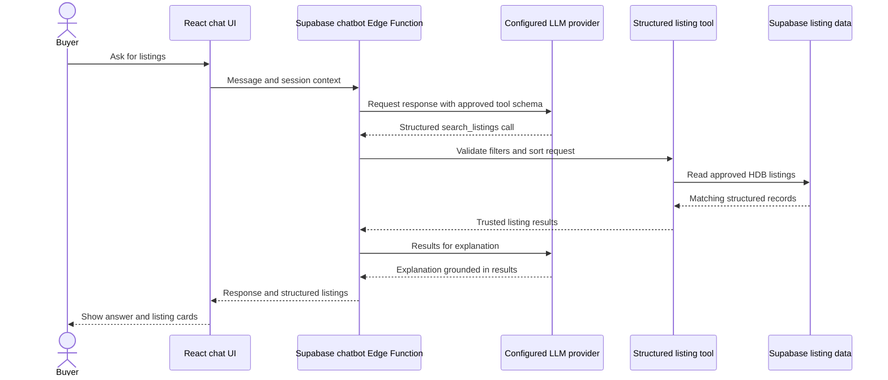
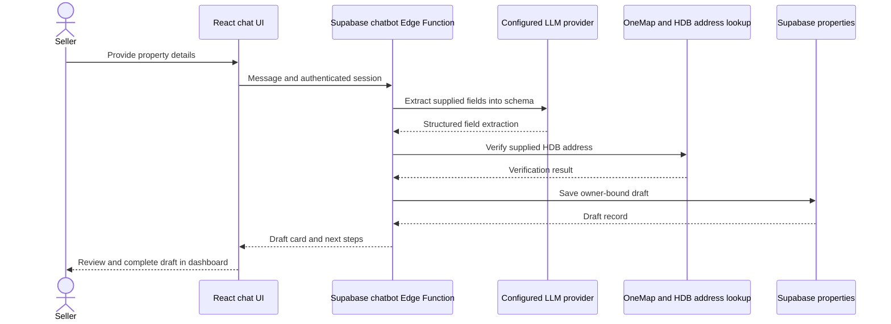

# SG Homie chatbot

The chatbot UI calls the Supabase `chatbot` Edge Function. OpenAI or OpenRouter can provide language responses through server-side configuration; bounded application tools handle listing search and seller draft intake. The model does not have arbitrary SQL access, and trusted application results take precedence over model memory.

## Buyer listing search

The buyer flow uses the read-only `search_listings` tool to search and sort approved HDB listings. It is not a personalized recommendation-ranking engine. The LLM can explain returned records but must not invent listing IDs, prices, amenities, distances, or valuation evidence.

*Search results come from the application tool. The language model explains them; it does not rank personalized recommendations.*

## Seller intake

Seller intake extracts details supplied in chat, verifies the HDB address through the location lookup, and saves an owner-bound draft. The seller reviews and completes the draft in the dashboard before submission. Any suggested asking price is provisional AI guidance based on application asking listings, separate from the CatBoost research/demo valuation.

*Address verification does not make other synthetic listing facts verified. Demo amenity records are synthetic; nearby amenity lookup is not implemented.*

## Detailed flows and setup

- [Buyer chatbot flow](../buy-flow.md)
- [Seller chatbot flow](../sell-flow.md)
- [Supabase provider configuration and function setup](../../BackEnd/supabase/README.md#chatbot-provider-selection)

Hosted provider configuration and deployment must be checked in the intended Supabase project; repository code alone does not establish hosted state.
