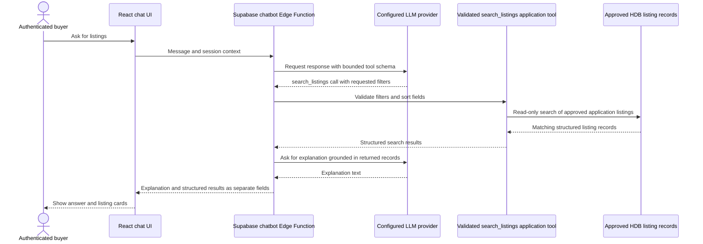
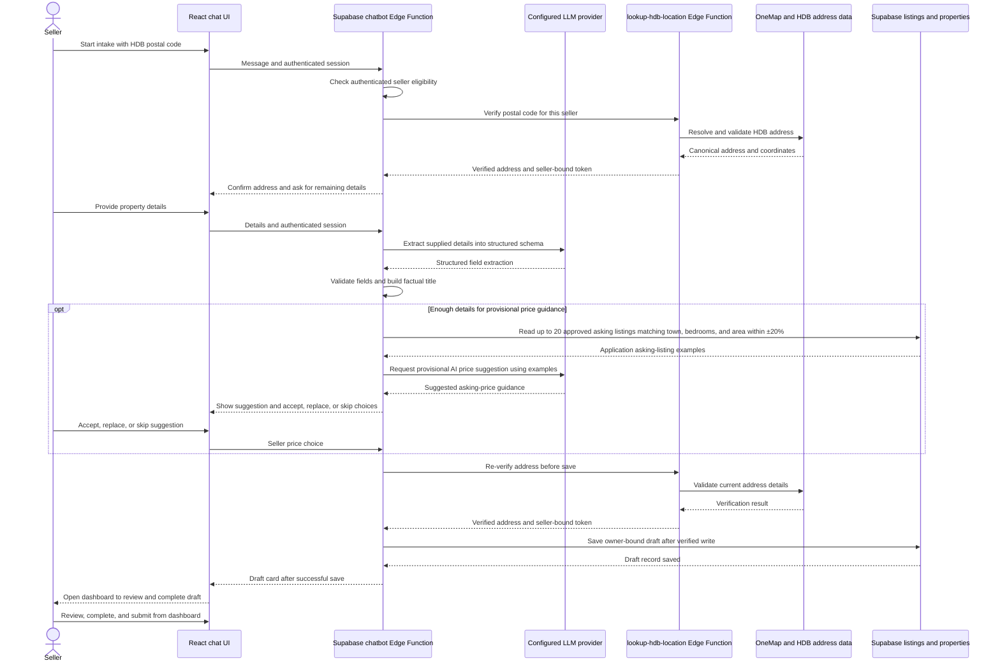

# SG Homie Chatbot

The chatbot UI calls the Supabase `chatbot` Edge Function. OpenAI or OpenRouter can provide language responses through server-side configuration; bounded application tools handle listing search and seller draft intake. The model does not have arbitrary SQL access, and trusted application results take precedence over model memory.

## Authentication and New Chat

Full AI conversation requires a registered Supabase user, verified server-side
before provider creation. Anonymous Buy/Sell are deterministic onboarding:
Buy can read a bounded summary of approved HDB application listings, and Sell
explains login and seller registration. Other anonymous text receives registration
guidance. Invalid/expired tokens and Supabase anonymous-user sessions cannot reach
AI, `search_listings`, seller intake or address verification. Catalog failures
return onboarding without fabricated counts or an AI fallback. Explore remains
login-protected; application asking listings may include demo records.

The header's **New chat** action clears temporary conversation history, input,
buyer filters and seller intake. It aborts/invalidates the old request and ignores
late responses while retaining login, profile preferences and saved application
data. Requests remain bounded to 20 messages of at most 4,000 characters each;
chat history is temporary context and no long-term conversation memory is
introduced. Authenticated buyer/seller/admin
permissions and database policies are unchanged.

## AI fair use and provider capacity

Registered-user AI paths reserve one user interaction before model processing.
The policy is server-configured by tier: standard starts at 2 interactions per
minute and 5 per Singapore calendar day, tester at 10 and 25, and privileged
at 20 per minute with no per-user daily cap. All tiers remain subject to abuse
cooldowns and project-wide capacity. A bare Buy request with saved preferences
still uses a provider call for the written explanation; database-only listing
search itself does not consume global provider capacity.

User interactions and provider calls are different units. Buyer tool selection
can retry up to three provider calls and a successful listing search can add a
separate explanation call. Seller detail extraction can make a second call for
provisional price guidance. The server reserves global capacity immediately
before each outbound provider request. The initial application reserve is 18
calls per minute and 45 per Singapore day; these are configurable application
defaults, not upstream provider guarantees. Five burst-limit denials in ten
minutes trigger a 15-minute chatbot-only cooldown. Quota denials return
structured HTTP 429 responses and safe current-user quota metadata in JSON or
an SSE `quota` event. The UI explains denials but does not yet show a usage
meter. Anonymous deterministic onboarding and non-AI application paths do not
consume either quota. Hosted policy and deployment state must be verified
separately.

## Privacy, telemetry and response feedback

Authenticated AI requests receive a server-generated UUID used as the request
and interaction identifier. The temporary conversation UUID is created in the
browser, reused for turns in that chat, and replaced on New Chat or account
change. It is correlation metadata only. A deliberately maintained prompt
version (`chatbot-v2`) changes when material system, buyer/seller policy, or
tool behavior changes; do not substitute a commit hash for the prompt version.

The repository records status/error category, quota outcome, requested provider
and model, returned model only when the provider supplies it, tool outcomes,
timing, and provider usage only when returned. A buyer turn can make several
provider calls, recorded as child rows. `first_output_event_ms` measures the
first non-empty application SSE event, not provider TTFT: current provider
responses are buffered before application streaming. Seller workflow text is
excluded from telemetry. Other stored user/assistant text and feedback comments
receive best-effort redaction and expire after 30 days. The Singapore-focused
phone matcher masks 8-digit numbers beginning with 6, 8 or 9, with optional
space/hyphen grouping and optional `65`/`+65` prefix. It is not global phone
detection and ambiguous 8-digit values may also be masked. Prices, six-digit
postal codes, block numbers, room counts and years are not matched solely for
being numeric. Synthetic smoke-test examples include `69304030`, `91234567`,
`81234567`, `+65 6930 4030`, `+65 9123 4567` and `65 8123 4567`; housing
examples to preserve include `$500000`, `560123`, `Block 123`, `4-room`,
`600000` and `2026`. Detection/redaction is not guaranteed to find every
sensitive fact. Metadata, structured feedback
reasons and opaque IDs can remain longer without user/conversation linkage after
content expires. Deleting an account cascades while its telemetry still carries
the user link.

Before authenticated AI processing, obvious API keys/tokens, bearer/JWT values,
payment-card-like values and Singapore NRIC/FIN values are blocked before quota
reservation and provider calls. Prices, postal codes and block numbers are not
blocked solely because they contain digits. A concise notice in the registered
chat explains temporary review/storage and third-party provider processing;
users should not submit passwords, keys, NRIC/FIN, payment details or other
sensitive information.

Buyer/general chat returns a deterministic privacy reminder for phone numbers
or email addresses in the latest user message before quota reservation, telemetry
start, or provider processing. Buyer/general model responses also receive an
output guard that replaces unsupported persistence or long-term memory claims
and prevents detected identifiers from being echoed. These checks do not apply
to the authenticated seller details-intake stage: validated seller contacts are
handled by that structured workflow, and its saved-draft confirmation is emitted
only after authorized database writes succeed. Both user and assistant telemetry
continue to use the same best-effort redactor.

Eligible successful AI answers show 👍 and 👎 controls. A user can change the
rating on the same interaction. Negative feedback supports multiple structured
reasons and an optional comment. The database derives ownership from the signed-in
user, rejects direct telemetry-table access, and redacts the comment before
storage. Feedback is evaluation data for reliability and quality work; it is not
automatically RLHF or model training. Failed telemetry writes do not break chat;
feedback save failures are reported inline. The cleanup function is implemented
in the repository, while its Supabase Dashboard schedule and hosted behavior
remain deployment-dependent; see the [deployment runbook](../operations/deployment-runbook.md#phase-4-chatbot-telemetry-and-feedback).

For authenticated AI requests, the server attempts an idempotent interaction
upsert before quota reservation and provider processing. JSON finalization is
awaited before the JSON response is sent. SSE finalization runs when the
application stream reaches EOF or is cancelled; the `[DONE]` event can arrive
before that final database update finishes, and the frontend drains the stream
through EOF. Start, provider-call and finalization writes each retry once.
Structured `chat_telemetry_write` logs include the interaction ID, operation,
outcome and attempt only; raw messages and database error text are not logged.
If retries fail, chat and quota enforcement continue. A persistent start failure
means the interaction may have no row; a persisted `started` row whose final
update fails is closed as an internal error by the one-hour cleanup when that
cleanup is scheduled. This is best-effort persistence, not a guarantee during a
database outage.

### Property access

Application navigation to `/property/:id` requires a registered user. Direct
URLs, browser history, chatbot links and Explore links pass through the same
route guard. The guard waits for Supabase session restoration and reacts to
sign-out while property details are open. An authenticated user may view details
without completing the buyer profile. This is an application route restriction;
the existing RLS policy still permits anonymous reads of approved property rows
through the Supabase Data API. No listing RLS or interest visibility policy is
changed by the route guard.

## Buyer listing search

The buyer flow uses the validated, read-only `search_listings` tool to search and sort approved HDB listings. It is not a personalized recommendation-ranking engine. The LLM can explain returned records but must not invent listing IDs, prices, amenities, distances, or valuation evidence.



*The tool performs validated, read-only listing search; it does not run arbitrary SQL. Structured results remain separate from the LLM explanation. Search and sorting do not provide personalized recommendation ranking or verify listing truth.*

## Seller intake

Seller intake verifies the HDB address, extracts details supplied in chat, and saves an owner-bound draft. The seller reviews and completes the draft in the dashboard before submission. Any suggested asking price is provisional AI guidance based on application asking listings, separate from the CatBoost research/demo valuation.



*The optional price suggestion is provisional LLM guidance based on application asking listings. It is separate from CatBoost valuation and is not completed-sale evidence. Address verification does not verify all listing facts; supplied details remain seller-provided. Saving creates an owner-bound draft, not an approved or published listing. The seller reviews and submits it from the dashboard.*

*Demo amenity records are synthetic; nearby amenity lookup is not implemented.*

## Detailed flows and setup

- [Buyer chatbot flow](../buy-flow.md)
- [Seller chatbot flow](../sell-flow.md)
- [Supabase provider configuration and function setup](../../BackEnd/supabase/README.md#chatbot-provider-selection)

Hosted provider configuration and deployment must be checked in the intended Supabase project; repository code alone does not establish hosted state.

Phase 1 regression checks (repository root):

```bash
node --experimental-strip-types --import ./SGHomie/tests/register-deno-imports.mjs --test SGHomie/tests/chat-onboarding.test.mjs SGHomie/tests/chat-session.test.mjs SGHomie/tests/buy-flow.test.mjs SGHomie/tests/sell-flow.test.mjs SGHomie/tests/chat-provider.test.mjs SGHomie/tests/chat-window.test.mjs
```

These use isolated fixtures and reject anonymous provider construction/calls.
They do not verify hosted deployment, paid provider access or hosted RLS state.
